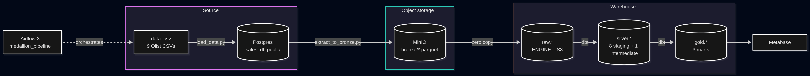
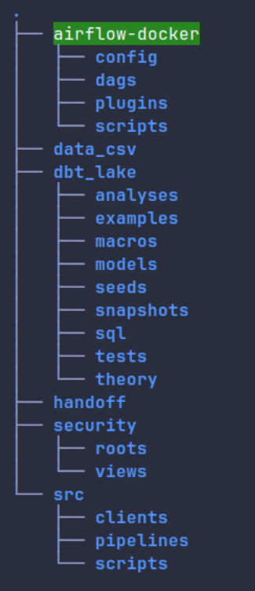
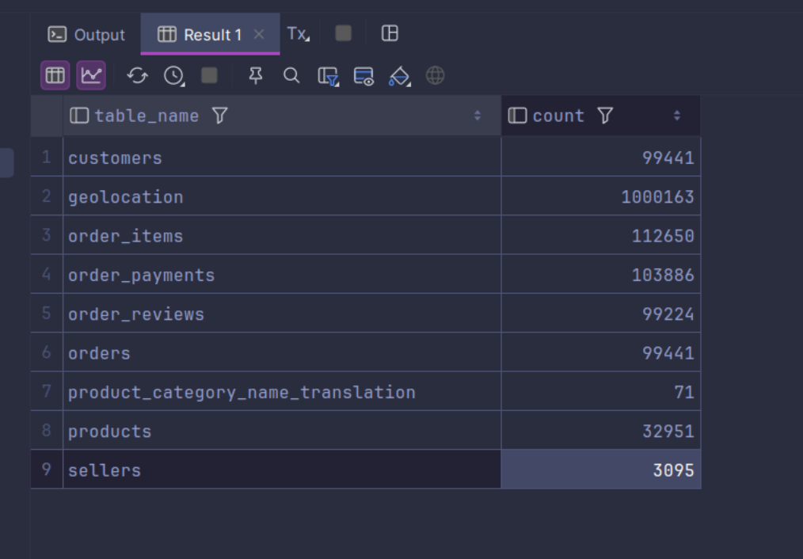
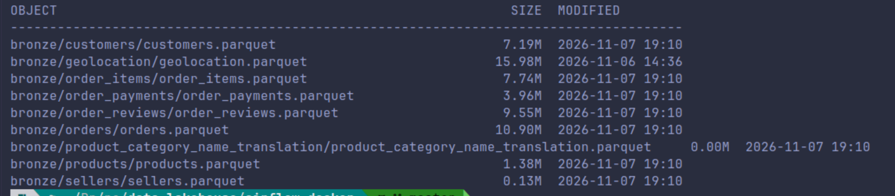
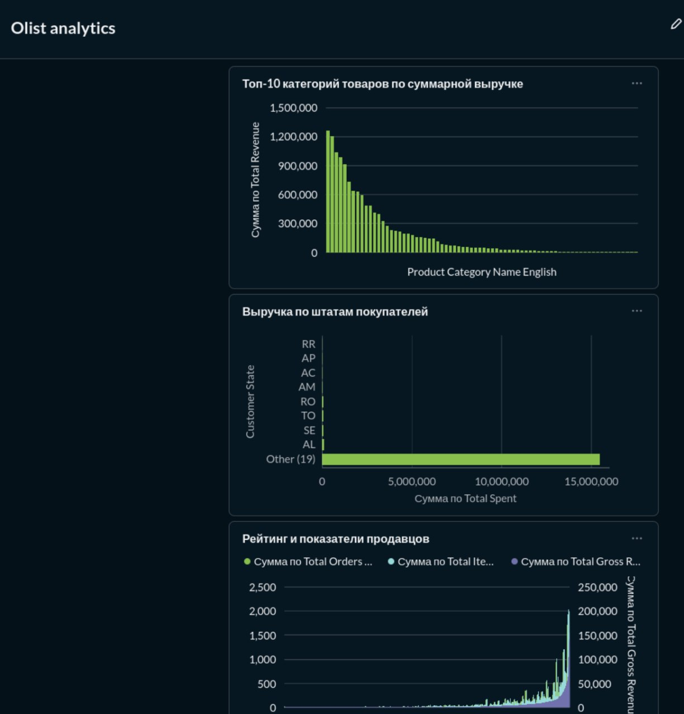
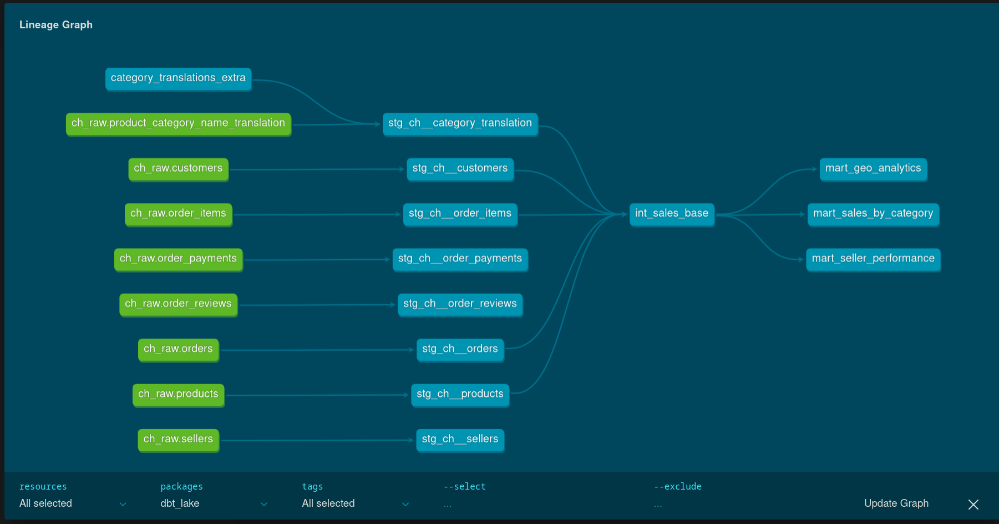
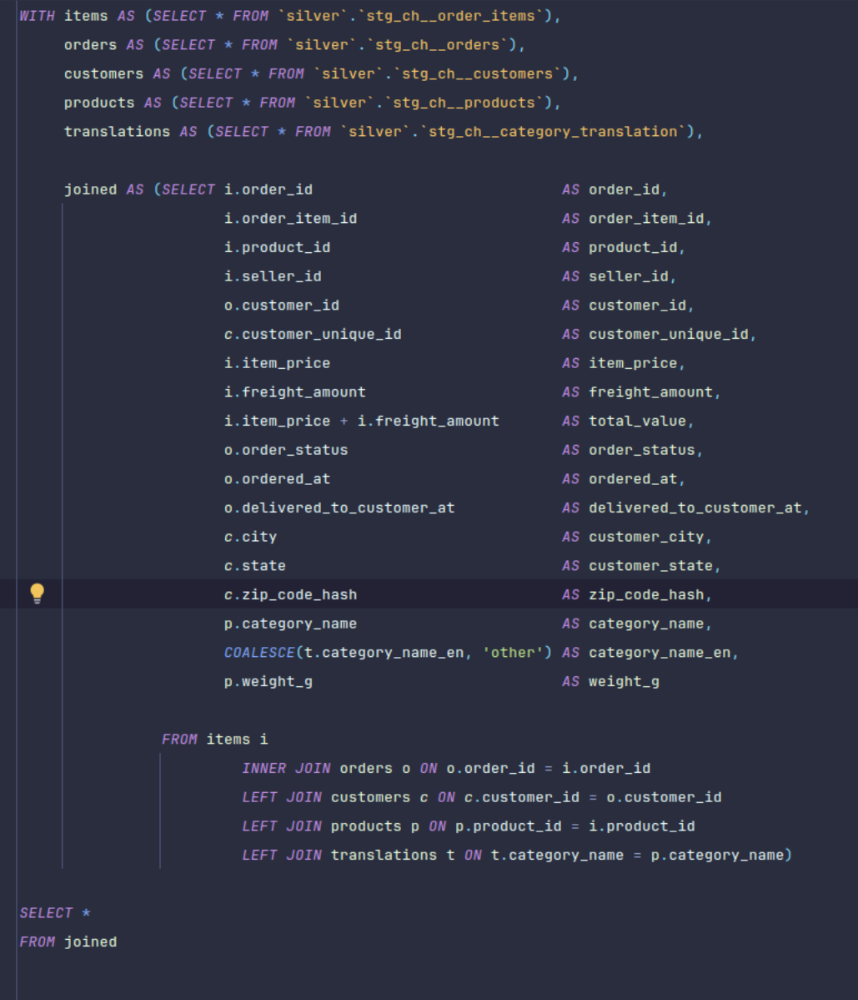
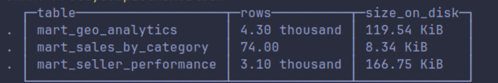
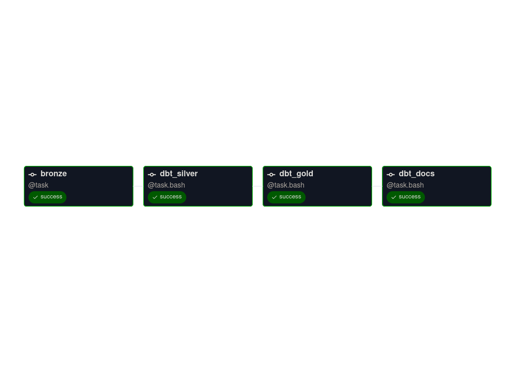
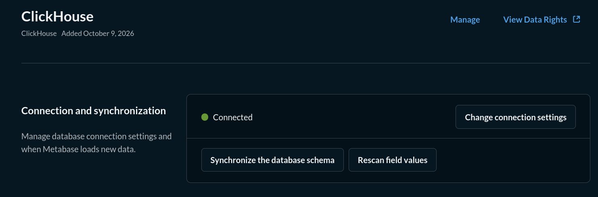

*How a pandas pipeline on the Olist dataset became a warehouse-shaped project with dbt, ClickHouse and a real orchestration layer.*


## 1. What this is

This project started as a data pipeline and ended up as a small warehouse. The difference matters: a pipeline moves rows from one place to another, while a warehouse has layers with contracts between them, tests that fail when a contract breaks, and a shared vocabulary that a business person and an engineer can both read.

The dataset is Olist — a Brazilian marketplace dump, nine CSV files, roughly a hundred thousand orders. Small enough to run on a laptop, messy enough to be realistic: inconsistent timestamps, missing values in columns that look important, product categories in Portuguese, prices and freight stored separately from the orders they belong to.

The work went in two large phases.

In the first phase I built the whole thing as a working pipeline. CSVs into Postgres, Postgres into object storage as Parquet, ClickHouse reading those Parquet files as tables it queries but does not store, transformations in pandas, dashboards in Metabase.

In the second phase I deleted the transformation half of that pipeline and rewrote it in dbt — not because pandas stopped working, but because the pandas version had three problems that no amount of careful coding would fix. That rewrite is the interesting part of the story, and it is what most of this document is about.


---

## 2. The dataset

Nine tables, and they are not all the same kind of thing. Understanding that was the first real design decision.

| Table | What it holds | Approximate rows |
|---|---|---|
| `orders` | One row per order: status, purchase date, delivery dates | 99,441 |
| `order_items` | One row per item inside an order: product, seller, price, freight | 112,650 |
| `order_payments` | One row per payment: type, installments, value | 103,886 |
| `order_reviews` | Review score and comment per order | 99,224 |
| `customers` | Customer id, zip prefix, city, state | 99,441 |
| `sellers` | Seller id, zip prefix, city, state | 3,095 |
| `products` | Product id, category name, physical dimensions | 32,951 |
| `geolocation` | Zip prefix → latitude, longitude | 1,000,163 |
| `product_category_name_translation` | Portuguese → English category names | 71 |

The grain is the thing to notice. `orders` is one row per order. `order_items` is one row per item, and an order can have several. That single fact determines every number in every dashboard afterwards: revenue summed at order grain and revenue summed at item grain are different numbers, and calling both of them "revenue" is how a warehouse loses trust.

`geolocation` is deliberately large and deliberately useless for the marts I built — I will come back to that as an honest loose end.

---

## 3. Step 0 — The repository, before any data moved

I wanted the layout to say out loud what each part of the system does, because a repository is read far more often than it is written.

```
data_lakehouse/
├── docker-compose.yaml          # postgres, minio, clickhouse, metabase
├── .env                         # credentials for the local stack
├── data_csv/                    # the raw Olist exports, untouched
├── src/
│   ├── config.py                # settings, loaded from .env
│   ├── clients/                 # Postgres and S3 clients
│   ├── scripts/load_data.py     # CSV → Postgres
│   └── pipelines/
│       ├── bronze/              # Postgres → Parquet in MinIO
│       ├── silver/              # (removed during the rewrite)
│       └── gold/                # (removed during the rewrite)
├── dbt_lake/                    # every transformation, from bronze onward
├── airflow-docker/              # Airflow 3, CeleryExecutor
└── security/                    # Metabase-facing views
```

Two rules made this layout work in practice.

First, infrastructure and application code live in separate mental boxes. `docker-compose.yaml` at the root brings up four services; `airflow-docker/docker-compose.yaml` is a second, independent compose file for the orchestration stack. They talk to each other over one shared Docker network, `de-network`, and neither is nested inside the other. I had the DAGs living inside `dbt_lake/` at first and it was wrong: the dependency only ever runs one way, Airflow calls dbt, never the reverse.

Second, the code that runs inside a container is written as if it lives in a container. Module names are short and absolute (`from config import settings`, not relative paths up three levels), and `PYTHONPATH` points at `src/`. The same import works on the laptop and inside the Airflow worker, which saves an entire class of "but it ran on my machine" conversation.



*Caption: The monorepo layout. Note that `dbt_lake/` and `airflow-docker/` are siblings, not parent and child.*

Ports, because they will come up constantly later:

| Service | Inside Docker | From the host |
|---|---|---|
| Postgres (source) | 5432 | 5433 |
| MinIO | 9000 / 9001 (console) | 9000 / 9001 |
| ClickHouse | 8123 (HTTP) / 9000 (native) | 8123 / 9009 |
| Metabase | 3000 | 3000 |
| Airflow | 8080 | 8080 |

---

## 4. Step 1 — Getting the CSVs into Postgres

The first hop is deliberately dumb. `load_data.py` reads each CSV with pandas and writes it into `sales_db.public` with `if_exists="replace"`.

That is not a real ingestion strategy and I know it. A real one would track watermarks, handle deletes, and probably never reload everything from a file on disk. But the point of this stage is to have a *source of truth that behaves like an operational database* — with types, keys, and a query planner — so that the extraction step downstream is a real extraction and not just `cp *.csv`. Postgres plays the role of the OLTP system here; the fact that it is being filled from CSVs instead of from an e-commerce backend is a detail of the scenery.

The one thing I did take seriously at this stage was types. Dates become `timestamp`, prices become `numeric`, ids stay `text` because Olist ids are hex strings with no meaning beyond their identity, and the zip-code prefix column stays `integer` — which will come back to bite me later in a way that turned out to be a genuine bug.


*Caption: The nine tables after loading. Everything downstream depends on this schema being stable.*

---

## 5. Step 2 — Designing the bronze layer

Bronze is the layer I made a promise about: it is a byte-faithful copy of the source, and nothing above it is allowed to change it.

Concretely, that means `extract_to_bronze.py` does exactly one thing — reads a table from Postgres and writes it as Parquet into MinIO — and it never filters, renames, casts, or joins. If a number looks wrong in a dashboard three layers up, bronze is the place I go to find out whether the wrongness was in the data all along or something I introduced.

The first version of this script was the naive one:

```python
df = pd.read_sql_table(table_name=table, con=engine)

parquet_buffer = io.BytesIO()
df.to_parquet(parquet_buffer, index=False, engine="pyarrow")
parquet_buffer.seek(0)

s3_client.upload_fileobj(
    parquet_buffer, settings.BRONZE_BUCKET, f"bronze/{table}/{table}.parquet"
)
```

Read the whole table, serialize the whole table, upload. For eight tables under a hundred thousand rows this runs fine, which is exactly why it is a trap: the `BufferError` arrives the day a table grows, not the day you write the code. And on this machine that day came early, because `geolocation` has a million rows and the container had a hard memory ceiling.

So I rewrote the extraction to stream. The table is read in chunks of 100,000 rows through a server-side cursor, each chunk is appended to a Parquet file on disk through `pyarrow.parquet.ParquetWriter`, and only the finished file is uploaded:

```python
with engine.connect().execution_options(stream_results=True) as conn:
    chunks = pd.read_sql(text(f'SELECT * FROM "{table}"'), conn, chunksize=CHUNK_SIZE)

    first = next(chunks, None)
    if first is None:
        raise RuntimeError(f"table '{table}' is empty")

    schema = pa.Table.from_pandas(first, preserve_index=False).schema
    writer = pq.ParquetWriter(path, schema, compression="snappy")

    try:
        for i, chunk in enumerate(chain([first], chunks), start=1):
            arrow = pa.Table.from_pandas(chunk, preserve_index=False).cast(schema)
            writer.write_table(arrow, row_group_size=ROW_GROUP_SIZE)
    finally:
        writer.close()
```

Three details in that snippet are not decoration.

`stream_results=True` is what makes the cursor server-side. Without it SQLAlchemy quietly fetches the entire result set into memory anyway, and the chunking is theatre.

The schema is taken from the first chunk and every later chunk is `.cast()` to it. `from_pandas` infers types per batch, so a chunk where a nullable column happens to be entirely `NULL` gets inferred as the `null` type, and the write fails on a schema mismatch that looks like a pyarrow bug but is not.

The writer is created *before* the `try`, and closed exactly once in the `finally`. My earlier version initialized `writer = 0` and then checked `if writer is not None`. Zero is not `None`, so the check passed, and the `finally` block called `.close()` on an integer — which both raised the wrong exception and masked the real one underneath. That was a two-hour bug in a five-line block.


*Caption: Nine Parquet files, one per source table. Bronze is written once per run.*

A note on layout, because it determines the next step. Each table gets its own prefix and a single file, `bronze/{table}/{table}.parquet`. I considered writing one file per chunk (`part-00000.parquet`, `part-00001.parquet`) which would let ClickHouse read them in parallel, and decided against it for now — it requires the ClickHouse table definition to use a wildcard path and it complicates re-runs, since stale parts from a previous run would silently duplicate rows. When the tables get genuinely large, that is the change to make, and the wildcard `*.parquet` in the engine definition is the detail that makes it work.

---

## 6. Step 3 — Teaching ClickHouse to read files it does not own

This is the step that changes what the project *is*. Before it, Parquet files in a bucket are just files. After it, they are queryable tables with a schema, and everything above can treat ClickHouse as a database rather than a file explorer.

Eight tables in the `raw` schema, each defined with the S3 engine:

```sql
CREATE TABLE raw.orders
(
    order_id String,
    customer_id String,
    order_status String,
    order_purchase_timestamp DateTime,
    order_approved_at Nullable(DateTime),
    order_delivered_carrier_date Nullable(DateTime),
    order_delivered_customer_date Nullable(DateTime),
    order_estimated_delivery_date Nullable(DateTime)
)
ENGINE = S3(
    'http://minio-lakehouse:9000/bronze/bronze/orders/orders.parquet',
    'minioadmin',
    'minioadminpassword',
    'Parquet'
);
```

The crucial property of `ENGINE = S3` is that it stores no data. The table is a pointer: every `SELECT` re-reads the Parquet file at that path. That has two consequences I ended up relying on. First, refreshing bronze requires no `INSERT` and no `TRUNCATE` — replacing the file is enough, and the next query sees the new numbers. Second, `count()` is a real read, so it is a trustworthy check, while `system.tables.total_rows` is always zero for this engine and means nothing (I lost a while to that).

A few choices worth naming:

*Nullable* columns are declared only where the source actually has them. `order_approved_at` is genuinely missing for cancelled orders; `order_id` is never missing. Marking everything nullable to be safe makes the SQL above it defensive for no reason and costs real memory in ClickHouse.

*The path is written out in full* in every table definition. It could come from a named collection or a config, and it should in a real deployment, but seeing the bucket and prefix spelled out in the DDL made debugging much faster during the migration.

*No partition, no order by, no primary key.* These tables are read once per dbt run and never optimized against. Every optimisation knob here is wasted.

To visualise what this buys: ClickHouse is not copying a million rows into its own storage to answer a query. It opens the Parquet, reads only the columns you asked for (which is the entire point of a columnar format), and returns them. The storage stays cheap and the compute stays in the database.

---

## 7. Step 4 — The first version of silver and gold, in pandas

This is the part that no longer exists in the repository, and it is worth describing, because the reason it was replaced is the actual story.

Silver took the eight raw tables, cleaned and joined them in pandas, and wrote nine Parquet files back to MinIO, into a bucket named `lakehouse`. Gold read those, aggregated into three marts, and wrote three more Parquet files. Metabase did not talk to ClickHouse's own tables at all — it talked to three views created in the `default` database, and those views were nothing but `s3()` calls pointing at the gold Parquet files:

```sql
CREATE VIEW default.mart_sales_by_category AS
SELECT * FROM s3(
    'http://minio-lakehouse:9000/lakehouse/gold/marts/*.parquet',
    'minioadmin', 'minioadminpassword', 'Parquet'
);
```

It worked. The dashboards rendered, the numbers were plausible, and the whole thing fit in a few files. Quality was enforced by a single script, `validate_order_data.py`, that you ran by hand after a run and that printed warnings to a terminal.


*Caption: The original dashboard over the pandas-built gold layer. Three cards, three views, no tests.*

So why throw it away? Three reasons, and they were not aesthetic.

**Memory.** Every transformation happened by materialising a DataFrame. Olist is small, so this looked free — but `geolocation` alone is a million rows, and the joins inside silver briefly held several copies of it. The container measured 765 MB at the peak against a server limit of about 763 MB. It survived by luck and by garbage collection arriving in time. On data ten times larger, the same code does not survive at all, and no amount of chunking fixes a `merge` between two large frames.

**No lineage, no tests that persist.** The pipeline had a fixed order of scripts and a `validate_order_data.py` that nobody ran on a schedule. If a column was missing from an intermediate Parquet, the failure surfaced two steps later as a `KeyError` in some mart, with nothing pointing at the cause. There was no way to ask "what reads this table?" other than grep.

**Duplication.** The three marts each rebuilt their own version of the base join: orders with items, with customers, with products, with sellers. The same `merge` chain written three times means three places to fix the same bug, and I had already fixed the same date-parsing bug in two of them.

The rewrite replaced all of that with a declarative layer where each model states what it wants and dbt works out the order, runs the tests, and draws the graph.

---

## 8. Step 5 — Why I threw the transformation layer away

The decision rule I settled on, and still think is right: **Python is for extraction and loading. Everything between bronze and the dashboard is SQL, and it is owned by dbt.**

That split is not arbitrary. Extraction is inherently imperative — connect, page through a cursor, handle a retry, upload a file. Transformation is inherently declarative — describe the result, let the engine figure out how. Forcing both into the same language means writing the second one as a sequence of steps, which is exactly what made the pandas version hard to reason about.

The concrete cost of that decision was about a week: setting up the dbt project, writing twelve models, porting the tests, and then proving that the new layer produced the same numbers as the old one.

That last part is the part I would keep if I could keep only one thing. A rewrite is only finished when you can demonstrate it changed nothing — except where it was supposed to.


*Caption: The lineage graph from `dbt docs`. Eight raw sources feed eight staging models, one intermediate model, three marts.*

---

## 9. Step 6 — Setting up the dbt project

`dbt_lake/` is a standard project, with three things worth calling out.

**Two targets, one for each database.** `profiles.yml` defines `pg_dev` and `ch_prod`. That pluralism is useful during development — you can build a model on Postgres to check the SQL is sound with plain types — but it is also a trap. Every command that touches ClickHouse has to say `--target ch_prod` explicitly, because the default is Postgres. I forgot twice, and once spent ten minutes looking for a model that had been built into the wrong database.

**Schema names are generated, not defaulted.** dbt's default behaviour appends the custom schema to the target's schema, so `silver` becomes `pg_dev_silver`, which is not what anyone wants in an analytics database. One small macro fixes it globally:

```sql

    
        {{ target.schema }}
    
        {{ custom_schema_name | trim }}
    

```

**Four packages, pinned.** `dbt_utils` for the useful generic tests and the date-spine helpers, `dbt_expectations` for row-level assertions, `dbt_date` for calendar logic, `codegen` for generating YAML from the warehouse. dbt 1.12 requires an explicit `version` key on every package entry, and silently skips entries that lack one — which reads as "the package installed but nothing works".

```yaml
packages:
  - package: dbt-labs/dbt_utils
    version: 1.3.0
  - package: calogica/dbt_expectations
    version: 0.10.4
  - package: calogica/dbt_date
    version: 0.10.1
  - package: dbt-labs/codegen
    version: 0.13.1
```

Materialisations follow the layer: staging as `table`, intermediate as `table`, marts as `table` with explicit ClickHouse engines. A view over an S3-backed table would re-read the Parquet on every query, which defeats the purpose of staging at all.

---

## 10. Step 7 — Staging: eight thin models over the raw tables

Staging models are boring on purpose. One model per raw table, named `stg_ch__<table>`, and each does exactly three things: select the columns explicitly, cast the types once, and rename to a consistent convention.

```sql
-- models/staging/stg_ch__orders.sql
SELECT
    order_id,
    customer_id,
    order_status,
    order_purchase_timestamp,
    order_approved_at,
    order_delivered_carrier_date,
    order_delivered_customer_date,
    order_estimated_delivery_date
FROM {{ source('raw', 'orders') }}
```

No joins. No filters beyond removing obvious garbage. No business logic, no aggregations, no `CASE` expressions that someone will later need to change. The value of this layer is not in what it computes but in what it guarantees: everything above can assume column names and types, and when the source changes, exactly one file needs editing.

Three things about staging took real effort.

**A column named `i.order_id`.** At some point during the migration a model produced a column whose *name* contained a dot — an alias like `i.order_id` survived into the `CREATE TABLE` statement. ClickHouse creates that table without complaint. The failure only appears later, when a mart selects it as `i.order_id` and the parser reads it as `i` dotted into `order_id`, which does not exist. The check that catches it is a query, not a test:

```sql
SELECT table, name FROM system.columns
WHERE database = 'silver' AND name LIKE '%.%';
```

Zero rows, or the layer is poisoned. The fix is dropping and rebuilding the affected tables, because the schema itself is wrong.

**Sorting keys and nullable columns.** ClickHouse refuses to sort on a nullable column (`Code: 44`). The tempting fix is `coalesce(column, 'unknown')` in the model, which turns a missing date into a fake date and quietly breaks any reconciliation against the source. The correct fix is a table setting:

```sql
{{ config(settings={'allow_nullable_key': 1}) }}
```

**Ordering in intermediate models.** A model with no meaningful sort order still needs *some* `order_by` in ClickHouse, and the naive one references a column that is not visible in the scope where the engine clause is evaluated, producing `Code: 47 UNKNOWN_IDENTIFIER`. Wrapping the select in a CTE does not help, because ClickHouse inlines CTEs. The fix is to say you have no order:

```sql
{{ config(order_by='tuple()') }}
```

---

## 11. Step 8 — The intermediate layer and the grain of a sale

One model: `int_sales_base`. It is the only place in the project where the six core tables are joined, and it exists precisely so that the three marts do not each build their own version of it.

The grain is **one row per order item**. Not per order — per item. Everything else follows from that decision:

```
order_items (one row per item)
  → join orders        on order_id          (order-level attributes: dates, status)
  → join customers     on customer_id       (state, city)
  → join products      on product_id        (category)
  → join sellers       on seller_id         (state, city)
  → join payments      on order_id          (rolled up to order level first)
  → join reviews       on order_id          (one row per order, so safely attached)
  → left join category translations on product_category_name
```

Two joins in that chain deserve a comment.

`order_payments` has *multiple rows per order* — installments. Joining it directly at item grain multiplies rows and inflates revenue, which is the single most common way a marketplace dashboard reports numbers that are too high. It has to be aggregated to order level before the join, and then attached.

`product_category_name_translation` is a lookup that does not cover every product. It must be a `LEFT JOIN`, and the resulting null category must be surfaced as `unknown` at the *mart* level, not silently dropped during the join. Dropping it would remove revenue from the total and nobody would notice until someone reconciled against the source.

Every column in this model has an explicit alias. That is not stylistic fussiness — the same column name exists in four tables (`city`, `state`, `zip_code_prefix`), and unaliased references are how `Code: 47` happens.

PII gets hashed here, once, through a macro (`hash_pii`) rather than in each downstream model, so the raw value never travels further than the intermediate layer.


*Caption: One join chain, aliased once, reused by all three marts.*

---

## 12. Step 9 — Three marts, three grains

Each mart answers one question for one audience, and states its grain in its own config so the answer cannot drift.

### `mart_sales_by_category` — 74 rows, one per product category

| Column | Meaning |
|---|---|
| `total_orders` | distinct orders containing the category |
| `total_items_sold` | item count |
| `total_revenue` | sum of item prices |
| `total_freight` | sum of freight |
| `avg_item_price` | average price per item |

### `mart_geo_analytics` — 4,300 rows, one per (state, city)

| Column | Meaning |
|---|---|
| `unique_customers` | distinct customers in the city |
| `total_spent` | sum of item prices |
| `avg_freight_cost` | average freight |

### `mart_seller_performance` — 3,095 rows, one per seller

| Column | Meaning |
|---|---|
| `total_orders_fulfilled` | distinct orders with at least one item from the seller |
| `total_items_sold` | item count |
| `total_gross_revenue` | sum of item prices |
| `first_order_at` | timestamp of the seller's first order |
| `last_order_at` | timestamp of the seller's last order |

All three are materialised as MergeTree tables in ClickHouse, which is the first time in the project that ClickHouse actually stores data of its own. That is deliberate: these are the tables Metabase queries on every page load, and re-reading Parquet for each dashboard refresh would be wasteful for data that changes once per pipeline run.

The `geo` and `seller` marts both sort on location and seller keys that can be null, so both carry `settings={'allow_nullable_key': 1}`. The alternative — inventing a placeholder — would have broken the row-level reconciliation I was about to run.


*Caption: The gold layer as real tables. Row counts match the source exactly.*

---

## 13. Step 10 — Replacing a validation script with 33 tests

The pandas version had `validate_order_data.py`: a script you ran manually, which printed warnings, which nobody acted on. The dbt version has 33 tests that run as part of the build and fail the run.

Four families of tests, all declared in `schema.yml` next to the models:

**`unique` and `not_null` on every primary key.** `order_id` in `stg_ch__orders`, `product_id` in products, and the composite key of every mart. This is the cheapest possible test and it catches the most expensive class of bug — a join that multiplied rows.

**`accepted_values` on categorical columns.** `order_status` may only be one of the eight known statuses. `review_score` is between 1 and 5. This is how a new status appearing in the source becomes a failing test instead of a wrong number on a dashboard.

**`relationships` across layers.** Every `customer_id` in the sales base must exist in `stg_ch__customers`. This catches broken joins and orphaned foreign keys at the point they are introduced, not three models later.

**Singular tests** in `tests/` for the rules that are specific to this business: freight is never negative, delivered dates are never earlier than purchase dates, revenue in a category mart equals the sum of its items in the base.

```yaml
models:
  - name: mart_seller_performance
    description: "One row per seller. Grain enforced by the unique test on seller_id."
    columns:
      - name: seller_id
        tests:
          - unique
          - not_null
      - name: total_gross_revenue
        tests:
          - not_null
          - dbt_utils.accepted_range:
              min_value: 0
```

The build output is the acceptance report:

```
Found 12 models, 1 seed, 33 data tests, 8 sources
Completed successfully
Done. PASS=44 WARN=0 ERROR=0 SKIP=0 TOTAL=44
```

`ERROR=0` is the number that matters, and it is the reason the whole rewrite was worth doing. In the pandas version, "did it work?" meant "did the script exit without an exception?", which is a much weaker question.

---

## 14. Step 11 — Seeds: the two categories that lived in Python

One of the four bugs found during the rewrite was this: two product categories had their English translation hardcoded in a Python dictionary inside the pandas silver step. It worked. But a mapping that lives inside a function is invisible to everyone who is not reading that function, and it cannot be reviewed, tested, or updated by anyone outside the code.

It became `seeds/category_translations_extra.csv`:

```csv
product_category_name,product_category_name_english
portateis_cozinha_e_preparadores_de_alimentos,kitchen_portables_and_food_preparers
pc_gamer,pc_gamer
```

Two rows. It took less time to move than to explain. That is usually the case with things that belong in a warehouse rather than in a script: the fixed cost is small, the question is only whether you notice the misplaced logic at all.

---

## 15. Step 12 — Orchestration on Airflow 3

One DAG, `medallion_pipeline`, four tasks, strictly sequential:

```
extract_to_bronze  →  dbt_silver  →  dbt_gold  →  dbt_docs
```


*Caption: Four tasks. Bronze cannot start until the source is loaded, and no transformation runs until bronze is complete.*

The dbt tasks shell out with explicit selectors and an explicit target:

```python
dbt build --target ch_prod --select +tag:silver --profiles-dir .
dbt build --target ch_prod --select +tag:gold   --profiles-dir .
dbt docs generate --target ch_prod --profiles-dir .
```

The `+` before the tag is not optional. Without it, dbt builds the tagged models and their children but *not their ancestors*, so a fresh warehouse would build marts against tables that do not exist.

Getting the DAG to run at all took two full evenings, and both causes were worth writing down.

**The `dbt_` prefix trap.** dbt 1.12 scans `sys.path` at import time and treats *any* module whose name starts with `dbt_` as a dbt plugin, importing it to look for a `plugins` attribute. My DAG file was named `dbt_lake_dag.py` and sat in `/opt/airflow/dags`, which is on `sys.path`. So the moment dbt started, it imported my DAG, which executed Airflow's `settings.initialize()` outside an Airflow process, which failed with `Could not parse SQLAlchemy URL` — an error with no obvious connection to what had actually happened. The fix is a naming rule that now feels obvious: **no file inside `dags/` starts with `dbt_`.**

**Three files, one `dag_id`.** During the migration I had accumulated three DAG files that all declared `dag_id="medallion_pipeline"`. Airflow did not complain loudly — it simply picked one, and I was editing a different one than the scheduler was reading. One file, one `dag_id`, no exceptions.

The container is a custom image on top of `apache/airflow:3.3.2`, with dependencies installed by `uv` as `--system` (Airflow runs its own interpreter, a virtualenv-based install is invisible to it). `requirements.txt` is generated by `uv export --frozen --no-dev --no-emit-project` and never edited by hand; the dbt pins live separately in `requirements-dbt.txt` so that regenerating the Airflow requirements cannot silently change the warehouse tooling.

Decorators use a compatibility shim, because Airflow 3 moved things around:

```python
try:
    from airflow.sdk import dag, task
except ImportError:  # Airflow 2 compatibility
    from airflow.decorators import dag, task
```

---

## 16. Step 13 — Proving the rewrite changed nothing (and fixed four things)

A rewrite is not done when the tests pass. It is done when you can prove the numbers did not move.

I compared the old and new layers at the row level, not the aggregate level. Same number of rows per mart, same set of keys, same values joined by key:

| Mart | Rows (old) | Rows (new) | Match |
|---|---|---|---|
| `mart_sales_by_category` | 74 | 74 | exact |
| `mart_geo_analytics` | 4,300 | 4,300 | exact |
| `mart_seller_performance` | 3,095 | 3,095 | exact |

Then the sums, which is where small differences would show up:

| Measure | Pandas | dbt | Delta |
|---|---|---|---|
| Category revenue | 13,591,643.70 | 13,591,574.86 | 68.84 (0.0005%) |
| Seller gross revenue | 15,843,553.24 | 15,843,425.84 | 127.40 (0.0008%) |

A delta of five parts per million is not zero, and I did not wave it away. It traces to two order items whose `order_id` appears in `order_items` but not in `orders` — in the old pipeline those rows were silently dropped by an inner join, in the new one they are handled by an explicit left join with a documented policy. A difference that small, explained, is a sign the reconciliation was done properly. A difference of zero would have meant I was not looking carefully enough.

**And the rewrite found four real bugs**, none of which were visible while the pandas version was "working":

| What it was | Why it was invisible | What it is now |
|---|---|---|
| A column called `avg_order_value` that actually stored the *minimum* order timestamp | nobody read the column definition, only the name | two columns: `first_order_at`, `last_order_at` |
| `avg_freiht_cost` — a typo in a column name | dashboards referenced the typo, so everything looked consistent | `avg_freight_cost` |
| `customer_zip_code_prefix` was overwritten with its own hash | the column still existed with a plausible type | original column preserved, hash added as `zip_code_hash` |
| two category translations hardcoded in Python | the categories rendered correctly | moved into `seeds/` |

The `avg_order_value` one is my favourite, because the name was not just slightly wrong, it described a completely different metric. Every consumer of that column believed they were looking at an average sale value and were actually looking at a date. It had been sitting there, disguised by a good name, and only a rewrite that forced me to write down what each column *means* exposed it.

---

## 17. Step 14 — Metabase, and the database that cannot be dropped

Metabase connects to ClickHouse over JDBC, HTTP port 8123, and reads only `gold`. Nobody should be able to query `raw` or `silver` from a dashboard — those layers are allowed to change shape, and a dashboard holding them in place is a dashboard that prevents refactoring.

Getting to that state involved debugging that had nothing to do with SQL, and it is worth recording because it is the kind of thing that repeats in every BI tool.

**Cards failed with a generic display error.** The cards were built when the connection exposed a `default` database containing three compatibility views (`default.mart_*` pointing at the old gold Parquet). When I changed the database list on the connection, Metabase re-introspected the schema, the cards lost their field references, and every one of them failed with "There was a problem displaying this chart" — which looks like a query error and is actually a metadata error.

**The `default` database cannot be removed.** It is ClickHouse's system database. Dropping it is not an option, and no amount of wanting it gone changes that. So "not having `default`" has to be achieved the other way around: keep no views in it, and point the connection at `gold` instead.

**One setting truncating every result.** `max_result_rows` set to 100 will happily cut a 4,300-row mart down to 100 rows, and the dashboard renders a plausible-looking chart with a tenth of the data. Any setting in that connection form is live ammunition: a single unknown key (I tried `allow_experimental_analyzer`, which the server version did not recognise) makes every query on the connection fail. The connection settings field stays empty.

The final state: two cards rebuilt against `gold` with correct field references, the connection exposing `gold`, and three marts that render exactly what ClickHouse stores.


*Caption: The connection after the fix — `gold` only, no settings overrides, JDBC compression off.*

---

## 18. Every error I hit, in one table

Because these are the useful part of any technical write-up, and because I want to find them again in a year.

| Symptom | Actual cause | Fix |
|---|---|---|
| `Code: 47 UNKNOWN_IDENTIFIER` | `order_by` references a column outside the engine clause's scope; a CTE wrapper does not help because ClickHouse inlines CTEs | `order_by='tuple()'` |
| `Code: 44 Sorting key contains nullable columns` | sorting key declared on a nullable column | `settings={'allow_nullable_key': 1}` |
| Mart breaks with a column called `i.order_id` | a dotted alias survived into `CREATE TABLE`; ClickHouse accepts it, then parses it as a qualified reference | `system.columns WHERE name LIKE '%.%'`, then drop and rebuild |
| `--select tag:gold` builds marts but not their inputs | tags select exactly what they match | `--select +tag:gold` |
| `raw.*` reports zero rows in `system.tables` | `ENGINE = S3` stores nothing, so `total_rows` is meaningless | `count()` against the table |
| Only one Parquet file read after chunking | the engine path names a single file | wildcard in the path: `*.parquet`, or `**/*.parquet` for subfolders |
| `Could not parse SQLAlchemy URL` when running dbt | dbt 1.12 imports every `dbt_*` module on `sys.path`; my DAG file was named `dbt_lake_dag.py` | rename the file; never start a DAG file with `dbt_` |
| Two DAGs, one `dag_id` | three files declared the same id | one file per `dag_id` |
| `AttributeError: 'int' object has no attribute 'close'` | `writer = 0` initialisation, and `0 is not None` is true | create the writer inside the `try`, close once in `finally` |
| Schema mismatch on the second chunk | `pa.Table.from_pandas` infers `null` type for an all-null batch | `.cast(schema)` to the first chunk's schema |
| `ValueError: Invalid endpoint: http://minio_lakehouse:9000` | underscores are illegal in hostnames; botocore rejects the URL before any network call | `minio-lakehouse` (the container name), and `localhost` from the host |
| `ModuleNotFoundError: No module named 'config'` | `src/` is the import root and was not on `PYTHONPATH` | `PYTHONPATH=src` on the host; already set inside the Airflow container |
| Metabase cards: "problem displaying this chart" | the connection's database list changed, Metabase re-introspected, cards lost field ids | rebuild the cards against the new schema |
| Dashboard shows 100 rows instead of 4,300 | `max_result_rows=100` in the connection settings | leave the settings field empty |

---

## 19. Appendix — commands worth remembering

```bash
# Run a single model and everything downstream of it
dbt build --target ch_prod --select int_sales_base+ --profiles-dir .

# Check for dashed column names that will break later
docker exec clickhouse-lakehouse clickhouse-client --password clickhouse --query \
  "SELECT table, name FROM system.columns WHERE database='silver' AND name LIKE '%.%'"

# Which storage path is each raw table actually reading?
docker exec clickhouse-lakehouse clickhouse-client --password clickhouse --query \
  "SELECT name, engine FROM system.tables WHERE database='raw'"

docker exec clickhouse-lakehouse clickhouse-client --password clickhouse --query \
  "SHOW CREATE TABLE raw.orders" | grep -oE "http://[^']+"

# Row counts, source versus bronze
docker exec clickhouse-lakehouse clickhouse-client --password clickhouse --query \
  "SELECT 'orders' t, count() FROM raw.orders
   UNION ALL SELECT 'customers', count() FROM raw.customers FORMAT PrettyCompact"

# Run the extraction the way production runs it
docker compose exec airflow-worker python -m pipelines.bronze.extract_to_bronze

# Prove the docs artifact is fresh
dbt docs generate --target ch_prod --profiles-dir .
```
---

*Dataset: [Brazilian E-Commerce Public Dataset by Olist](https://www.kaggle.com/datasets/olistbr/brazilian-ecommerce), Kaggle.*
