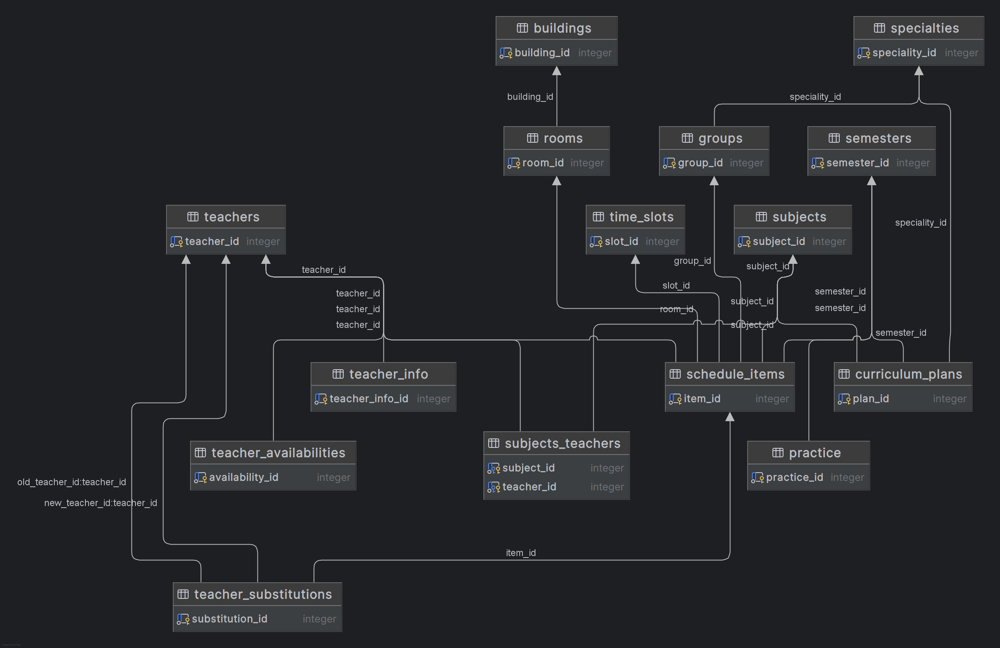

This is a database for university management system. The database layer is done: thirteen entities, every relationship, every constraint, every migration.

That asymmetry is the reason this write-up exists. Most portfolio projects show the finished surface. What I actually want to share is what it took to get the data model right before a single endpoint existed — the decisions I argued with myself about, the two design mistakes I made and had to undo, and one thing I know is still broken. The API is the easy part once the model tells you what it can and cannot allow.

The system covers the full academic cycle: academic programs with different curricula and durations from two to seven years, student cohorts, semester planning, room and teacher scheduling, and teacher substitutions.

---

## 1. The domain, before any tables

I spent a full day with a notebook before opening an editor, and it paid for itself twice over. The entities I ended up with:

```
specialities              academic programs ("09.03.02 Information Systems")
subjects                  courses taught within a program
teachers                  instructors
groups                     student cohorts
semesters                  academic periods
rooms                      classrooms
time_slots                 the grid: weekday + period
schedule_items             one actual class: group + teacher + room + date + slot
schedule_plans             which subject belongs to which program semester
practices                  internships and practical training
teacher_availability       when a teacher can be scheduled
teacher_substitutions      who covers whom, for one specific class
teacher_subjects           which teacher can teach which subject
```

The one entity that decides everything else is `schedule_items`. It is the only table where a real conflict can physically happen, and it is the only table whose constraints must be strong enough that no application bug can get around them.

Three things about the domain that a naive schema gets wrong:

A group is not tied to one subject. In a given week a group has six or seven different classes, so the group-to-subject relationship runs through the schedule, not through the cohort.

A teacher is not tied to one group either, and can teach the same subject to several groups in the same semester.

A class has three resources that must each be unique at any moment — the group, the teacher, and the room — and all three live in a single row.


*The final schema. Thirteen tables; the cluster on the right is the schedule itself.*

---

## 2. Integrity lives in the database, not in the application

This is the central decision of the project, so I want to state it as a rule rather than a preference: **anything that must never happen is enforced by a constraint, and a constraint is enforced because the storage engine refuses the write, not because a service function remembered to check.**

The reason is not paranoia about my own code, it is arithmetic. A rule checked in Python runs once per code path. The same rule checked by the database runs for the API, for a script, for a fix applied in `psql` at 2 a.m., and for the endpoint I will write next year and forget the rule applies to.

```sql
CREATE TABLE schedule_items (
    id           uuid PRIMARY KEY DEFAULT gen_random_uuid(),
    group_id     uuid NOT NULL REFERENCES groups(id)      ON DELETE RESTRICT,
    teacher_id   uuid NOT NULL REFERENCES teachers(id)    ON DELETE RESTRICT,
    room_id      uuid NOT NULL REFERENCES rooms(id)       ON DELETE RESTRICT,
    subject_id   uuid NOT NULL REFERENCES subjects(id)    ON DELETE RESTRICT,
    class_date   date NOT NULL,
    time_slot_id uuid NOT NULL REFERENCES time_slots(id)  ON DELETE RESTRICT,
    activity_type activity_type NOT NULL,

    CONSTRAINT uq_schedule_group_slot
        UNIQUE (group_id, class_date, time_slot_id),
    CONSTRAINT uq_schedule_teacher_slot
        UNIQUE (teacher_id, class_date, time_slot_id),
    CONSTRAINT uq_schedule_room_slot
        UNIQUE (room_id, class_date, time_slot_id)
);
```

Each of those three constraints encodes one sentence in plain language. A group cannot be in two places at once. A teacher cannot be in two places at once. A room cannot host two classes at once. Together they turn "build a scheduler endpoint" from *a problem of remembering to check* into *a problem of catching an exception* — the database raises SQLSTATE `23505` and the API turns it into a `409 Conflict` with a message that names the conflicting resource.

The same philosophy shows up in the smaller decisions. `NOT NULL` on everything that is meaningless when missing. `CHECK` for domain values that could change. `ON DELETE RESTRICT` everywhere a deletion would silently destroy scheduling history — a teacher who has taught is never deleted, they are deactivated.

### Where the guarantee ends

It would be dishonest to stop there, because there is a hole in it, and I know exactly where.

`teacher_substitutions` stores `old_teacher_id` and `new_teacher_id` and points at a specific `schedule_item_id`. The unique constraints above protect the *planned* schedule. A substitution does not modify `schedule_items` — it adds a row somewhere else. So if the substitute is already teaching a different class at the same date and slot, the database will accept it without a murmur, because as far as `schedule_items` is concerned nothing changed.

Closing that hole properly means either an exclusion constraint over a joined representation of the actual schedule, or a trigger on `teacher_substitutions` that checks availability at insert time. I have not built either yet. Writing down where my guarantee stops took ten minutes and is worth more than the paragraph above claiming it covers everything.

---

## 3. Four design decisions worth explaining

### 3.1 Many-to-many between teachers and subjects

A teacher teaches several subjects; a subject is taught by several teachers. The alternative I considered was storing an array on the teacher row:

```json
{ "teacher_id": "...", "subjects": ["math", "physics"] }
```

I rejected it for a reason that is not about purity. An array column cannot hold anything *about* the relationship. The moment you need to record how many hours a week a given teacher handles a given subject, or from which semester that permission applies, the array has nowhere to put it — and neither does any other column on either table. You end up creating the junction table anyway, having spent the migration budget twice.

So `teacher_subjects` exists from the start with two foreign keys and a composite unique constraint, and it has room to grow:

```sql
CREATE TABLE teacher_subjects (
    teacher_id uuid NOT NULL REFERENCES teachers(id) ON DELETE CASCADE,
    subject_id uuid NOT NULL REFERENCES subjects(id) ON DELETE CASCADE,
    hours_per_week smallint,          -- nullable: not every assignment specifies hours
    PRIMARY KEY (teacher_id, subject_id)
);
```

`ON DELETE CASCADE` is right here specifically because this table represents a *permission*, not a fact with history. If a subject is removed from the curriculum, its teaching permissions should disappear with it. That is the opposite of the `RESTRICT` used everywhere in `schedule_items`, and the difference between the two is the whole point.

### 3.2 Practices belong to semesters, not to groups

This was my first real mistake, and I undid it.

My initial design linked `practices` directly to `groups`, which reads as obvious: each group has its own practical training, so each group gets its own rows. What I had actually built was a duplication machine. Three groups in the same semester have *identical* practice periods. Changing a date meant updating every group's copy. Adding a group meant copying the whole set again, hoping I did not miss a row.

The error was not in the code, it was in the level of the relationship. Practices are an attribute of the semester; groups merely belong to a semester.

```
before:  groups ──< practices            (N copies of the same dates)
after:   groups >── semesters ──< practices   (one copy, shared)
```

Each group points at `current_semester_id`, and reaching its practices is a two-hop join. When practice dates change, one row changes. When a new group appears, it inherits them for free.

The general lesson is the one I keep re-learning: if the same data is stored twice, the duplication is a symptom and the cause is always a relationship modelled at the wrong level. Fixing it in code means writing a synchronisation routine forever.

### 3.3 Substitutions as a first-class entity

A teacher is ill on Thursday. Someone covers their 10:20 class. The naive way to store this is to update `schedule_items.teacher_id` — and it destroys the information that a substitution happened, who originally taught, and why the room booking looks odd.

Instead `teacher_substitutions` holds `schedule_item_id`, `old_teacher_id` and `new_teacher_id`, all referencing existing tables, plus a reason and a timestamp:

```python
schedule_item_id: Mapped[UUID] = mapped_column(
    ForeignKey("schedule_items.id", ondelete="RESTRICT"), nullable=False
)
old_teacher_id: Mapped[UUID] = mapped_column(
    ForeignKey("teachers.id", ondelete="RESTRICT"), nullable=False
)
new_teacher_id: Mapped[UUID] = mapped_column(
    ForeignKey("teachers.id", ondelete="RESTRICT"), nullable=False
)
```

Two foreign keys pointing at the same table is the standard shape for this, and it needs one addition people forget — a check that you are not substituting someone with themselves, which is a business rule with no other place to live:

```sql
CONSTRAINT check_different_teachers CHECK (old_teacher_id <> new_teacher_id)
```

### 3.4 Enums for closed vocabularies, and the price of that choice

`activity_type` has four values: lecture, seminar, practical work, laboratory work. `shift` has two. I originally had a lookup table for activity types — four rows, joined into every schedule query, to gain nothing, since these values are part of the domain definition and will not be edited by a user.

PostgreSQL enum types give the validation without the join. Internally the value is a four-byte reference into `pg_enum`, so storage is compact, and the sort order follows the declaration order, which is exactly what you want for `shift` (first shift before second).

The cost is real and should be stated: adding a value means `ALTER TYPE ... ADD VALUE`, and since PostgreSQL 12 that can run inside a transaction but *the new value cannot be used until the transaction commits*. Renaming a value is possible; removing one is genuinely awkward. That is the correct trade for a vocabulary that is part of the schema's meaning, and the wrong trade for anything a business user might edit — categories, departments, and similar belong in tables, not enums.

---

## 4. Models: the parts that are not boilerplate

SQLAlchemy 2.0 with typed mappings, and mixins for the audit columns that would otherwise appear, identically and slightly wrong, in thirteen places.

```
UUIDPKMixin       uuid primary key, server-generated
TimestampMixin    created_at, set once by the database
UpdatedAtMixin    updated_at, rewritten on modification  (see below)
CreatedByMixin    nullable FK to the user who created the row
UpdatedByMixin    nullable FK to the user who last changed it
```

Two honest notes, because both are things I got wrong at first or would get wrong again.

**`updated_at` was client-side, and I thought it was server-side.** The mapping is `server_default=func.now()` plus `onupdate=func.now()`, and that combination looks symmetrical enough to be convincing. It is not: `server_default` runs in the database, `onupdate` runs in the ORM when it emits an `UPDATE`. A direct `UPDATE` from `psql`, or any other application, leaves the column untouched. Real server-side behaviour needs a trigger. For an API-only database the ORM version is acceptable; calling it "the server rewrites the timestamp" is not, so the docs now say what it actually is.

**UUIDv4 was the right call here, and it has a cost I only understood later.** Random identifiers are safe to expose in URLs and impossible to enumerate. They also scatter index inserts across the whole b-tree, because new rows land in random pages instead of at the end — more page splits, more index bloat, more work for autovacuum. UUIDv7 keeps the same 128 bits, is time-ordered, and gets the insert locality back. At this database's size it changes nothing measurable; if writes ever became the bottleneck, that is the first thing I would switch.

---

## 5. Pydantic schemas: where validation belongs, and where it does not

Four schemas per model, which sounds like ceremony until you try to use one schema for four purposes.

```
Base       business fields + validation rules, shared
Create     Base + foreign keys; never audit fields
Update     all fields optional, for PATCH
Response   Base + id + audit fields, from_attributes=True
```

The placement rule I settled on is simple: **a rule that protects storage goes in the database; a rule that protects meaning goes in the schema.** "No two classes in the same room at the same time" protects storage, and belongs in a constraint. "A schedule item cannot be created in the past" is a policy of the business, could reasonably change, and would be very annoying to alter as a database constraint — so it lives in a validator.

```python
class GroupBase(BaseSchema):
    name: str = Field(..., min_length=1, max_length=10,
                      pattern=r"^[А-ЯЁA-Z0-9-]+$", description="Academic group name")
    year: int = Field(..., ge=1, le=7, description="Current academic year (1-7)")
    shift: Shift = Field(..., description="Study shift")
    student_count: int = Field(..., ge=1, le=40, description="Students in the group")


class GroupCreate(GroupBase):
    speciality_id: UUID
    current_semester_id: UUID


class GroupUpdate(BaseSchema):
    name: str | None = Field(None, min_length=1, max_length=10,
                             pattern=r"^[А-ЯЁA-Z0-9-]+$")
    year: int | None = Field(None, ge=1, le=7)
    shift: Shift | None = None
    student_count: int | None = Field(None, ge=1, le=40)
    speciality_id: UUID | None = None
    current_semester_id: UUID | None = None
```

Two details in that snippet are the ones that actually bite.

The name pattern is `[А-ЯЁA-Z0-9-]`, with `Ё` explicitly included. Cyrillic `А`–`Я` runs from U+0410 to U+042F; `Ё` is U+0401, outside the range. A group named `МО-ЁЖ-21` would have been rejected with a message that made no sense, and the bug would have looked like a client problem. I caught it by typing real group numbers into the pattern instead of trusting that the range covered the alphabet.

`GroupUpdate` inherits from `BaseSchema`, not from `BaseModel`, for the same reason the other three do: shared configuration, including `from_attributes`. Allowing one schema in the set to quietly lose the base config is how an inconsistency survives a code review.

---

## 6. Indexing: what the planner actually needs

### 6.1 A correction I had to make to my own thinking

My first draft of this section said "every foreign key gets an index automatically". That is wrong, and it is a mistake worth leaving visible, because it leads to a slow query nobody investigates.

PostgreSQL automatically indexes the **referenced** side of a foreign key — `teachers.id` must be unique to be referenced at all, so it has a unique index. The **referencing** side gets nothing. `schedule_items.teacher_id` is an ordinary column with no index at all, and a query asking for one teacher's classes scans the whole table.

So the rule I follow now is not "foreign keys are indexed", it is: **every foreign key that appears in a `WHERE` clause gets an explicit index.** In practice that is nearly all of them here, but the reasoning is what makes it a design decision rather than a ritual.

```sql
CREATE INDEX ix_schedule_items_teacher_date ON schedule_items (teacher_id, class_date);
CREATE INDEX ix_schedule_items_group_date   ON schedule_items (group_id,   class_date);
CREATE INDEX ix_schedule_items_room_date    ON schedule_items (room_id,    class_date);
CREATE INDEX ix_schedule_items_date         ON schedule_items (class_date);
```

Note the shape: `(teacher_id, class_date)` rather than two separate indexes. PostgreSQL can combine single-column indexes with a Bitmap Index Scan, and it does — but that means scanning both indexes, building two bitmaps, intersecting them, and then fetching heap pages. A compound index answers the same query with a single ordered range scan, and it also serves queries that filter by `teacher_id` alone, since it is the leftmost column.

The last index, on `class_date` alone, exists for a different query: the calendar view, which asks for everything happening this week regardless of who or where.

### 6.2 Measuring instead of asserting

I did not want to write "compound indexes are faster" without a number behind it. Method: `EXPLAIN (ANALYZE, BUFFERS)`, warm cache, three runs, median reported. Dataset: a seeded schedule of roughly a hundred thousand `schedule_items`, generated rather than real — worth saying explicitly, so no one mistakes it for production volume.

Query: all classes of a given teacher.

| | Plan | Execution |
|---|---|---|
| Separate single-column indexes | `BitmapAnd` → `Bitmap Heap Scan`, 2 index scans | <!-- your measurement --> — ms |
| Compound `(teacher_id, class_date)` | `Index Scan` | <!-- your measurement --> — ms |

<!-- Fill both cells with your own numbers. If you want to state a multiplier,
     state it next to these two numbers and nowhere else. -->

### 6.3 What I deliberately did not index

`activity_type` has four possible values. An index on it would be a b-tree with four distinct keys and a hundred thousand duplicates of each — the planner would rather scan the table than use it, and every insert would pay for maintaining a structure nobody reads. Low-cardinality columns are the classic case where an index is pure cost.

The same logic applies to every boolean-ish column in the schema. In a larger system those become **partial indexes** (`WHERE status = 'active'`) or are handled by a **covering index** with `INCLUDE`, both of which encode selectivity into the index itself rather than hoping the planner guesses. I have not needed either here yet.

### 6.4 The swap problem, and deferrable constraints

One consequence of the three unique constraints that I only discovered by trying to use my own database: swapping two classes between rooms fails.

If class A is in room 1 and class B is in room 2, and you want them the other way round, the first `UPDATE` puts A into room 2 — which is still occupied by B, because B has not been updated yet. The constraint fires at statement level, the transaction aborts, and a task that sounds trivial ("swap these two") cannot be expressed as a normal update.

The fix is to declare the constraints `DEFERRABLE INITIALLY IMMEDIATE`: they behave exactly as before in normal use, but a transaction that knows it will produce a temporarily inconsistent state can defer the check to commit:

```sql
ALTER TABLE schedule_items
    DROP CONSTRAINT uq_schedule_room_slot,
    ADD CONSTRAINT uq_schedule_room_slot
        UNIQUE (room_id, class_date, time_slot_id)
        DEFERRABLE INITIALLY IMMEDIATE;
```

This is safe here specifically because no foreign key references these three-column combinations — PostgreSQL requires foreign keys to point at a non-deferrable unique constraint, and none of mine do. Deferring a constraint that other tables depend on is a much more delicate operation.

---

## 7. Three things I got wrong

I had written APIs before. I had used SQLAlchemy in small projects. This was the first time I designed a schema with thirteen interconnected tables and had to live with the consequences of every decision, and the mistakes were not coding mistakes — they were judgement calls made too early.

**Over-normalisation cost me a join table for four values.** Early on I was rigorous to the point of absurdity: a lookup table for activity types with a foreign key in `schedule_items`, then a join on every schedule query for a set of values that would never change. I even had a lookup for shifts. The database was perfectly normalised and perfectly pointless — the only thing the structure bought was complexity. Replacing those tables with enum types kept the validation and removed the join. Normalisation is about eliminating redundant *facts*; a fixed vocabulary of four values is not a redundant fact, it is part of the schema's definition.

**Duplication was a symptom of a relationship at the wrong level.** The practices-into-groups mistake from §3.2 is the version of this I remember because fixing it required admitting the model, not the code, was wrong. Every time I have encountered duplication since, the useful question has been "which entity does this attribute actually belong to", and never "which function should copy it more reliably".

**I indexed columns and never looked at a plan.** Before this project, "add an index" was a reflex performed when something felt slow. Then I opened `EXPLAIN ANALYZE` and discovered the query I thought was indexed was doing a sequential scan over the whole table, twice, and that the two columns I had indexed separately were being combined with a bitmap intersection that cost more than it saved. Opening the planner output is not a skill on top of SQL; it is part of writing SQL.

---

## 8. Closing

The thing this project changed in how I work is smaller and more useful than a list of lessons: I no longer start with endpoints. A schema is a set of statements about what is possible, and every statement is cheaper to change before it has code hanging off it. Drawing thirteen entities and their relationships on paper, arguing with myself about whether practices belong to a group or a semester, was not preparation for the work — it was the work.

The architecture is not perfect. The substitution gap is real, and I named it rather than hiding it. But every table, constraint and index in here exists because I could say, out loud, what breaks if it were absent — and that is the difference between a schema that survives contact with an application and one that gets rewritten around it.
